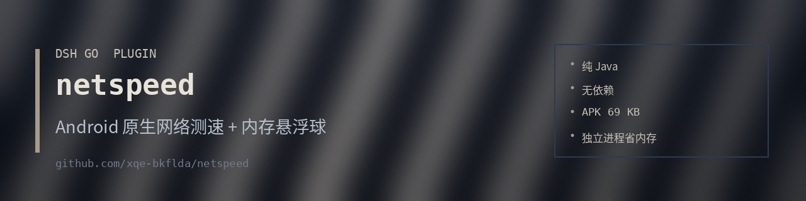

<div align="center">
  
</div>

<p align="right">
  <a href="README_EN.md">English</a> · <b>中文</b>
</p>

<p align="center">
[](LICENSE)
  [](https://github.com/xqe-bkflda/netspeed/stargazers)
  [](https://github.com/xqe-bkflda/netspeed/releases)
</p>

# 测速 NetSpeed

Android 原生网络测速 + 内存悬浮球。纯 Java，**无第三方依赖**，APK 69 KB。

## 功能

**测速**：下载 / 上传 / 延迟 / 抖动。下载源并发探测择优，Range 分段多线程；上传多线程 POST；延迟用 TCP 握手取中位数。

**悬浮球**：只显示内存占用百分比 + 一圈用量弧。数字严格居中（字体度量算基线，不是写死偏移）。

- 单击 → 弹出两行：`RAM 5.6G/11.3G 55%` / `DISK 202GB/256GB 83%`
- 拖动 → 跟手（绝对坐标换算，不是累加位移）
- 长按 → 立刻贴边隐藏
- 空闲 3 秒 → 自动贴边 + 半透明
- 点贴边那条边 → 拿出来

## 省内存的做法

| 项 | 做法 |
|---|---|
| 进程 | 悬浮服务独立 `:float` 进程，和主界面分开算 |
| 内存读数 | `/proc/meminfo` 用 `FileInputStream` 就地扫字节，全程不 new String |
| 磁盘读数 | `StatFs` 一次调用，不遍历目录 |
| 面板 | 只有 2 个 TextView，收起即置 null |
| 重绘 | 百分比没变就不 `invalidate()` |
| 测速 | 8 KB 缓冲，32 MB 总量上限，不落盘 |
| 通知 | `IMPORTANCE_MIN`，不响不横幅 |

## 颜色分档

`< 75` 绿 · `75–90` 黄 · `> 90` 红

## 编译

需要 JDK、Android SDK build-tools（aapt2 / d8 / apksigner）。

```bash
./build.sh .
```

`env.sh` 里改这四个路径：

```bash
export ANDROID_JAR=/path/to/android-34/android.jar
export ANDROID_D8=/path/to/build-tools/lib/d8.jar
export ANDROID_KS=/path/to/debug.keystore
```

无 Gradle、无 AndroidX，一个 shell 脚本直接出 APK。

## 安装

`apk/netspeed-v1.2.apk`，或自己编译。首次启动需授予「显示在其他应用上层」权限。

## 结构

```
src/com/y/netspeed/
  MainActivity.java   主界面 + 测速调度
  FloatService.java   悬浮球服务（独立进程）
  BallView.java       自绘悬浮球
  Net.java            测速核心（下载/上传/延迟）
  Mem.java            内存与磁盘读数
  Notif.java          前台通知
```

## License

MIT
